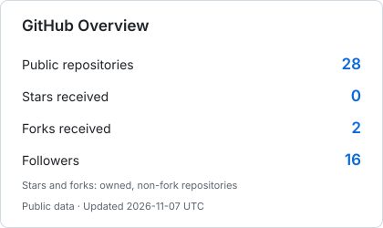
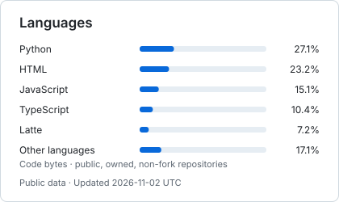
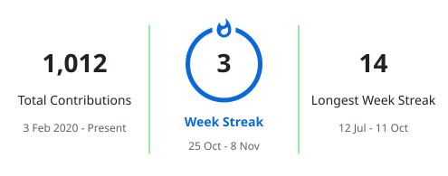

<!-- Personal profile banner-->
<h1 align="center">
    
</h1>

<!-- Typing svg presentation-->
<div align="center">
    <a href="https://hajisml.github.io">
        <picture>
            <source media="(prefers-color-scheme: dark)" srcset="https://readme-typing-svg.demolab.com?font=Fira+Sans&size=22&duration=4000&pause=1000&color=F0F6FC&center=true&vCenter=true&width=410&lines=We+%CE%94re+%CD%B6ot+%CD%B2he+%CF%9E%CE%B1%CF%BBe%2C+I'%CF%BB+%CE%94+%CF%BB%CE%B1rti%CE%B1%CE%B7;-+lil+W%CE%B1y%CE%B7e" />
            
        </picture>
    </a>
</div>
<!-- Socials-->
<div align="center" >
    <a href="https://dev.to/hajisml"></a>
    <a href="https://linkedin.com/in/hajisml"></a>
    <a href="https://www.youtube.com/@hajsml"></a>
    <a href="https://www.twitch.tv/hajisml"></a>
    <a href="https://x.com/hajisml"></a>
    <a href="https://mastodon.social/@hajisml"></a>
    <a href="https://substack.com/@hajisml"></a>
    <a href="https://t.me/hajisml"></a>

<!-- Donations-->
<h6 align="center">₿ Bitcoin: bc1q9vyjnvxjkk40mjqf6cgkadklfxrug5ez6kzpxx<br>⚡Lightning: middleamber84@walletofsatoshi.com</h6>
</div><br>

<!-- About me server in Go -->
```go
package main

import (
	"encoding/json"
	"log/slog"
	"net/http"
	"time"
)

type Profile struct {
	Name      string   `json:"name"`
	Location  string   `json:"location"`
	Focus     []string `json:"focus"`
	Portfolio string   `json:"portfolio"`
}

func aboutMe(w http.ResponseWriter, _ *http.Request) {
	me := Profile{
		Name:      "Haji Ismael Ibrahim",
		Location:  "Lakecity",
		Focus:     []string{"Backend development", "Distributed systems", "Design"},
		Portfolio: "https://halim.is-a.dev",
	}

	w.Header().Set("Content-Type", "application/json")
	if err := json.NewEncoder(w).Encode(me); err != nil {
		log.Printf("write profile response: %v", err)
	}
}

func main() {
	mux := http.NewServeMux()
	mux.HandleFunc("GET /about", aboutMe)

	server := &http.Server{
		Addr:              ":8080",
		Handler:           mux,
		ReadHeaderTimeout: 5 * time.Second,
	}
	if err := server.ListenAndServe(); err != nil {
		slog.Error("server", "err", err)
		os.Exit(1)
	}
}
```

<!-- About / Present -->
### 💡 Present

I'm **Haji Ismael Ibrahim**, a software engineer based in Lakecity. I build backend services with Go, Python, and well-tuned databases, with a focus on concurrency, socket programming, and distributed systems.

- 🧑🏾‍💻 Software Engineering Apprentice at [Zone01 Kisumu](https://zone01kisumu.ke).
- 🛠️ Building [Kamugram](https://github.com/hajisml/kamugram), a Swahili search engine and Telegram bot.
- 📚 Learning **full-stack Java development with Spring Boot**, from REST APIs to the front end.
- 🎨 Alongside code, I work on **brand identity and UI/UX** using Figma, GIMP, and Inkscape.
- 🌐 Explore my work at [halim-c4x.pages.dev](https://halim-c4x.pages.dev).

<!-- GitHub Statistics -->
### 📊 GitHub Statistics

<div align="center">
    <a href="https://github.com/hajisml?tab=repositories">
        <picture>
            <source media="(prefers-color-scheme: dark)" srcset="assets/overview-dark.svg" />
            
        </picture>
        <picture>
            <source media="(prefers-color-scheme: dark)" srcset="assets/languages-dark.svg" />
            
        </picture>
    </a>
</div>

<div align="center">
    <a href="https://git.io/streak-stats">
        <picture>
            <source media="(prefers-color-scheme: dark)" srcset="assets/streak-dark.svg" />
            
        </picture>
    </a>
</div><br>

<!--START_SECTION:dev-excuse-->
<p align="center">
    <em>“The coffee mαchiηe ϟtopped workiηg todαy!”</em><br>
    <sub>— <a href="https://excuser-three.vercel.app">Excuser</a></sub>
</p>
<!--END_SECTION:dev-excuse-->

<details>
  <summary><b>⏳ View my WakaTime Statistics</b></summary>

<!--START_SECTION:waka-->
**📊 This Week I Spent My Time On**

```text
Programming Languages:
Bash                     29 mins           ████████████████████ 100.00 %
```

Last 7 days · Updated 2026-11-09 UTC · Source: [WakaTime](https://wakatime.com/@00a59a24-7f70-4add-abf2-ff361b4693fc)
<!--END_SECTION:waka-->

</details><br>

<details>
  <summary><b>🧠 View my Skills and Knowledge</b></summary><br>

<table>
    <tr><th>Area</th><th>Experience with</th></tr>
    <tr>
        <td>Languages</td>
        <td>
            
            
            
            
            
            
        </td>
    </tr>
    <tr>
        <td>Web and APIs</td>
        <td>
            
            
            
            
            
            
        </td>
    </tr>
    <tr>
        <td>Data and Infrastructure</td>
        <td>
            
            
            
            
            
            
            
            
        </td>
    </tr>
    <tr>
        <td>Engineering Practices</td>
        <td>Distributed systems · Concurrency · Socket programming · CI/CD · Code review · Mentorship</td>
    </tr>
    <tr>
        <td>Design</td>
        <td>
            
            
            
            <br>Brand identity · UI/UX
        </td>
    </tr>
    <tr>
        <td>Currently Learning</td>
        <td>
            
            
            <br>Full-stack Java development, from REST APIs to the front end
        </td>
    </tr>
    <tr>
        <td>Education</td>
        <td>Software Engineering Apprentice at <a href="https://zone01kisumu.ke">Zone01 Kisumu</a> · B.Sc. Software Development, KCA University</td>
    </tr>
</table>

</details><br>

<!-- Updates -->
<details>
  <summary><b>🚀 Updates</b></summary><br>
    <ul>
        <li>🛠️ Working on <a href="https://github.com/hajisml/kamugram">Kamugram!</a></li>
        <li>🧑🏾‍💻 Apprentice at <a href="https://zone01kisumu.ke">Zone01 Kisumu</a></li>
        <li><a href="https://wakatime.com/@00a59a24-7f70-4add-abf2-ff361b4693fc"></a></li>
    </ul>
</details><br>

<!-- Footer -->
<div align="center">
<h6 align="center">- Mαrtiαηϟ VϞ Gobliηϟ -</h6>
</div>
